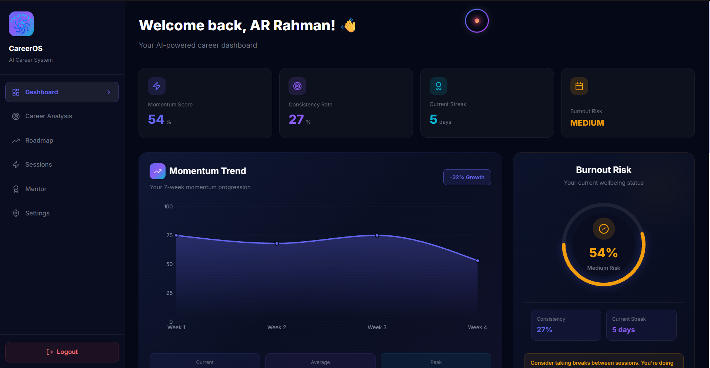
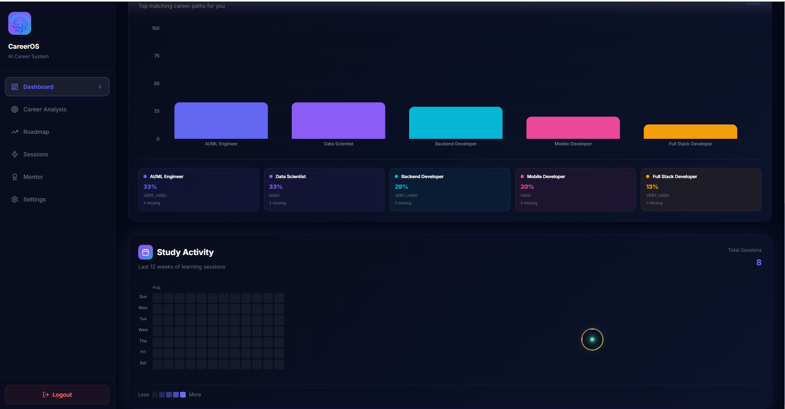
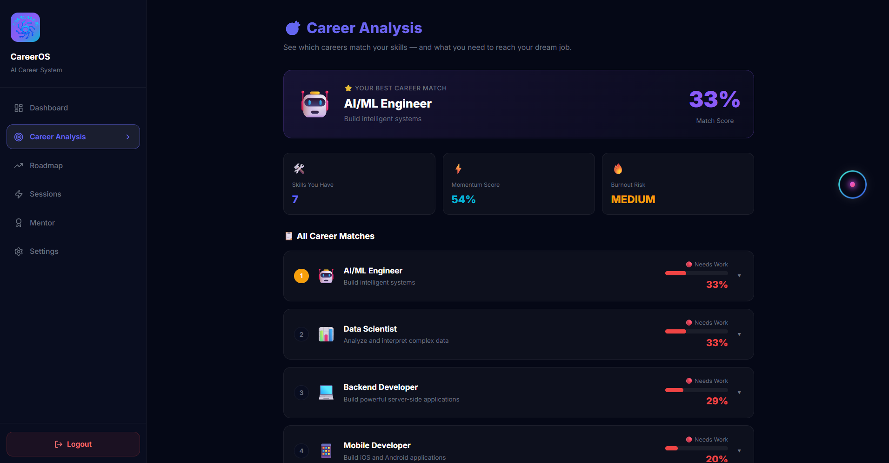
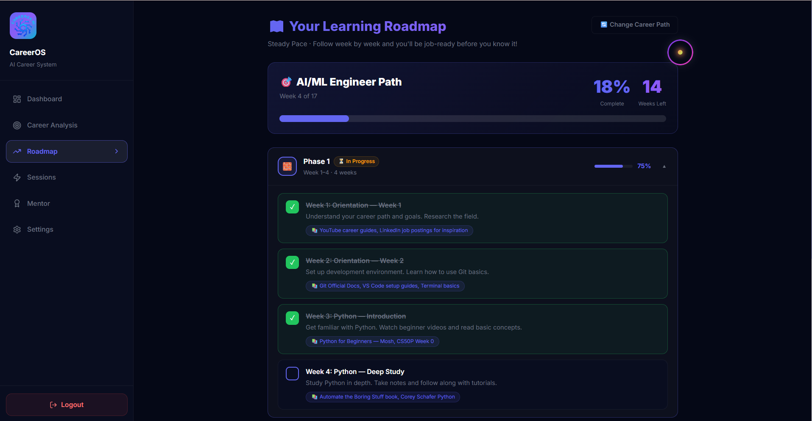
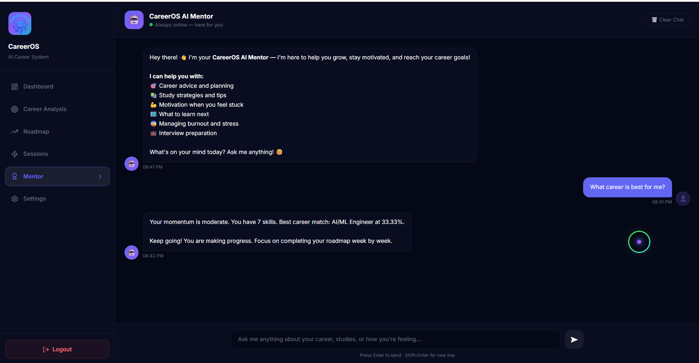
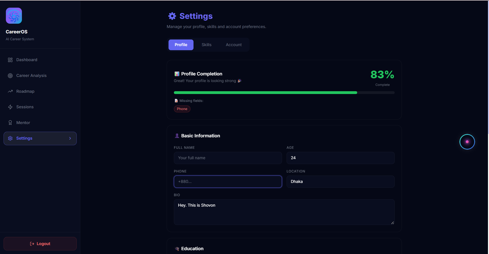

# CareerOS AI

**An AI-powered career guidance platform that shows you how ready you really are for a career, and warns you before you burn out.**

[](https://youtu.be/WmHjuP_j0M0)

▶️ **[Watch the 70-second demo on YouTube](https://youtu.be/WmHjuP_j0M0)**

---

## The Problem

Students and early-career professionals often don't know which career fits their skills, what they are missing, or whether their study habits are sustainable. Most tools answer only one of these questions. CareerOS AI puts them in one place.

## Features

| Feature | What it does |
|---|---|
| **Career Match** | Compares your skills with career paths and shows a match %, matched skills and missing skills |
| **Momentum Score** | Calculates learning momentum from your study sessions (productivity, consistency, duration) |
| **Burnout Risk** | Classifies risk as LOW / MEDIUM / HIGH from recent activity and mood |
| **Study Session Log** | Log topic, duration and mood; every session feeds the analytics |
| **Study Activity Heatmap** | GitHub-style 12-week activity view |
| **Learning Roadmap** | Step-by-step, phase-based learning path with progress tracking |
| **AI Mentor** | Chat assistant for career advice, study tips and motivation |
| **Profile Completion** | Live completion tracker that shows which fields are still missing |
| **Secure Auth** | JWT authentication with BCrypt password hashing |
| **UI** | Dark and light theme, responsive layout, animated charts |

## Screenshots

| Dashboard | Dashboard (continued) |
|---|---|
|  |  |

| Career Analysis | Learning Roadmap |
|---|---|
|  |  |

| AI Mentor | Profile Settings |
|---|---|
|  |  |

## Tech Stack

**Backend:** Java, custom REST API (`com.sun.net.httpserver`), JWT, BCrypt, JDBC, Gson
**Database:** MySQL
**Frontend:** React, Vite, Framer Motion, Recharts, Lucide Icons

## Architecture

Layered backend under `com.careeros`:

```
controller  →  service  →  repository  →  MySQL
   (HTTP)     (business)    (JDBC)
```

- **controller:** HTTP handlers; each validates the JWT and delegates to a service
- **service:** business logic (career matching, momentum and burnout calculation, roadmap generation)
- **repository:** data access, using a singleton `DatabaseManager`
- **ai:** `AIEngine` abstraction, `MentorAI`, and the roadmap **Strategy pattern** (`FastLearner` / `NormalLearner` / `SlowLearner` strategies created through `RoadmapStrategyFactory`)
- **model / util:** domain entities, JWT, password hashing and HTTP helpers

Design patterns used: **Singleton** (database and config managers), **Strategy** and **Factory** (adaptive roadmap).

## Project Structure

```
careeros-ai/
├── src/            Java REST API
├── frontend/       React + Vite app
├── database/       MySQL schema and seed data
└── screenshots/    Images used in this README
```

## Getting Started

### Prerequisites
- JDK 17+
- MySQL 8+
- Node.js 18+

### 1. Database
```sql
-- run the schema file in MySQL
SOURCE database/Database.sql;
```

### 2. Backend / src
1. Copy `database.properties.example` to `database.properties` (in the backend resources folder) and fill in your MySQL credentials.
2. Open `backend/` in your IDE, add the dependencies (Gson, jBCrypt, MySQL Connector/J and the JWT library used by `JwtUtil`), and run `ApiServer.java`.
3. Check: `http://localhost:8080/api/health`

### 3. Frontend
```bash
cd frontend
npm install
npm run dev
```
Open `http://localhost:5173`, register a new account, then fill in your profile and skills and log a few study sessions to see the analytics come alive.

## API Overview

| Method | Endpoint | Purpose |
|---|---|---|
| GET | `/api/health` | Server status |
| POST | `/api/auth/register` | Create account |
| POST | `/api/auth/login` | Login, returns JWT |
| GET / POST | `/api/profile` | Read or update profile |
| GET / POST | `/api/sessions` | List or log study sessions |
| GET | `/api/burnout` | Momentum score, streak, burnout risk |
| GET | `/api/careers/analyze` | Career match analysis |
| GET | `/api/careers/gap` | Skill gap for one career |
| GET | `/api/careers/paths` | All career paths |
| GET | `/api/careers/skills` | All skills |
| GET | `/api/careers/my-skills` | Skills of the logged-in user |
| POST | `/api/careers/skills/add` | Add a skill to the user |

All endpoints except health, register and login require `Authorization: Bearer <token>`.

## Current Status and Roadmap

Honest status of what is complete and what is next:

- ✅ Authentication, profile, skills, sessions, momentum and burnout analytics, career matching
- ✅ Dashboard with charts and activity heatmap
- 🔄 **AI Mentor:** currently answers with a rule-based engine; connecting an LLM API is planned
- 🔄 **Learning Roadmap:** the frontend currently shows curated learning paths; connecting it to the backend adaptive strategy engine (Fast / Normal / Slow learner) is planned
- 📌 Planned: notification system, cognitive fingerprint view, admin panel, PDF resume export

## Author

**[AR Rahman Iftekhar Shovon]**

[LinkedIn]  (https://www.linkedin.com/in/ar-rahman-iftekhar-shovon/)

[GitHub]    (https://github.com/AR-Rahman-Iftekhar-Shovon)

Feedback and suggestions are welcome. Feel free to open an issue.
